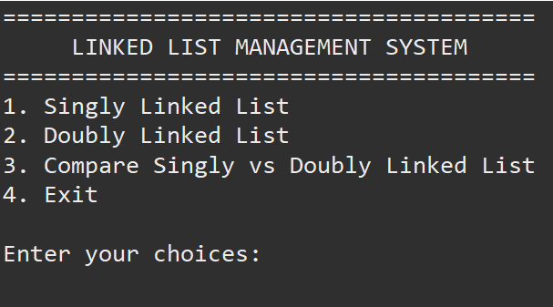

# Linked List Management System

A robust, menu-driven Java application providing manual pointer-level implementations for both **Singly Linked Lists** and **Doubly Linked Lists**. Designed to demonstrate low-level pointer updates, memory optimization, and foundational data structure operations without relying on built-in collection classes.

---

##  Project Objectives

- Implement low-level dynamic memory and pointer management in Java.
- Compare memory footprint and performance characteristics between Singly and Doubly Linked Structures.
- Build an interactive, terminal-based user interface for real-time list manipulation.

---

##  Technology Stack & Requirements

- **Language:** Java (JDK 8 or higher)
- **Environment:** Terminal / Command Line Interface (CLI) / Eclipse / VS Code
- **Core Library Usage:** Custom pointer nodes (`Node` class), minimal use of standard library except standard `Scanner` for I/O and `Set` for $O(n)$ duplicate removal.

---

##  Features & Supported Operations

Both Singly and Doubly Linked List modules support the following operations:

1. **Insertion Operations:**
   - Beginning
   - End
   - Specific Position (0-Indexed)
   - After a Target Node
   - Before a Target Node

2. **Deletion Operations:**
   - Beginning
   - End
   - Specific Position (0-Indexed)
   - Target Node by Value

3. **Query & Utility Operations:**
   - Linear Search (Returns 0-based index)
   - Value Update
   - Forward Display / Traversal
   - Backward Display *(Doubly Linked List only)*
   - Node Count Calculation
   - Find Maximum & Minimum Values
   - Find Middle Element (Two-Pointer / Fast & Slow approach)

4. **Algorithmic Transformations:**
   - In-place Reversal (Pointer flipping)
   - Sorting (Bubble sort via value swapping)
   - Duplicate Removal ($O(n)$ using `HashSet` lookups)

5. **Architectural Comparison Module:**
   - Direct side-by-side terminal breakdown comparing Singly vs. Doubly memory overhead, pointer counts, and operation complexities.

---

## ⏱️ Complexity Analysis

| Operation | Singly Linked List | Doubly Linked List | Notes / Trade-offs |
| :--- | :---: | :---: | :--- |
| **Insert at Beginning** | $O(1)$ | $O(1)$ | Direct pointer re-assignment |
| **Insert at End** | $O(n)$ | $O(1)$ | Doubly list uses `tail` tracking |
| **Insert at Position / Node** | $O(n)$ | $O(n)$ | Requires traversal to target location |
| **Delete from Beginning** | $O(1)$ | $O(1)$ | Immediate head shift |
| **Delete from End** | $O(n)$ | $O(1)$ | Doubly list moves via `tail.prev` |
| **Search / Find Min / Find Max** | $O(n)$ | $O(n)$ | Full linear scan required |
| **Reverse** | $O(n)$ | $O(n)$ | In-place link swap |
| **Sort** | $O(n^2)$ | $O(n^2)$ | Bubble sort implementation |
| **Remove Duplicates** | $O(n)$ | $O(n)$ | Uses Hash-set for secondary lookup |

---

##  How to Compile & Run

### 1. Compilation
Navigate to your project source directory and compile all source files:
```bash
javac LinkedList.java SinglyLinkedList.java DoublyLinkedList.java Main.java
```

### 2. Execution
Run the compiled `Main` class:
```bash
java Main
```

---

## 🖼️ Sample Outputs 

### Main Menu & Module Selection



### Singly Linked List Operations


### Doubly Linked List Operations 


### Feature Comparison Table


---

## 👤 Author

- **Developer:** [Tushar Mishra]
- **Submission Date:** 25 October 2026
